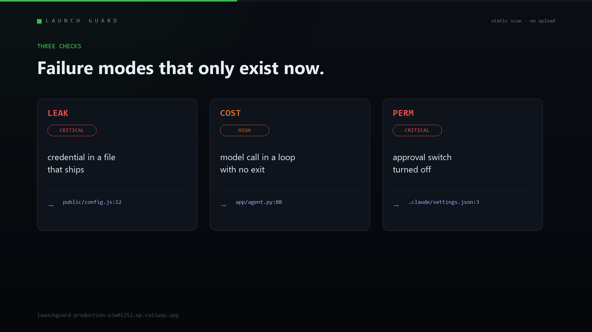
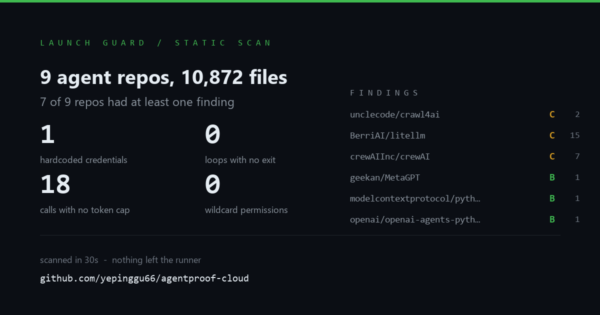

# Launch Guard

Three checks for the failure modes that only exist once an AI writes your code.

**[Scan a public repo →](https://launchguard-production-e3a01252.up.railway.app)** · no signup, ~20 seconds, nothing uploaded.



| Check | What it catches |
|---|---|
| **LEAK** | A provider key committed to the repo, or wired into `NEXT_PUBLIC_` / `VITE_` / `REACT_APP_` / a file that ships to the browser |
| **COST** | A model call inside a `while True` with no exit, a call with no output-token cap, an agent executor with no iteration ceiling |
| **PERM** | `dangerouslySkipPermissions`, `allowedTools: ["*"]`, a policy that allows `*` by default |

None of them is a CVE. All three are billed to you.

## Why this exists

In 2026 the expensive incident is no longer only "a vulnerability shipped". It is:

```python
while True:
    out = client.chat.completions.create(model="gpt-4o-mini", messages=[...])
    yield out.choices[0].delta.content
```

No `break`, no `max_tokens`, SDK default retries. It passes review, it compiles, and it costs money on every iteration until something else stops it — a rate limit, a stack trace, or your card.

Linters check syntax. Dependency scanners check versions. Reviewers check intent. Nobody checks the invoice.

## Evidence, not vibes

The scanner was run over 9 widely used agent / MCP repositories — 10,872 files, 31 seconds:

| Found | Count |
|---|---|
| hardcoded credentials | 1 |
| uncapped model calls | 18 |
| committed `.env` files | 2 |
| CVEs | 0 |



The libraries were clean: adapters forward `**kwargs`, vendors pass budgets explicitly, nobody hardcodes a key in a published package. The findings live in application code.

While running it on real repositories, five false-positive classes surfaced and were fixed (adapter methods treated as callers, a CI key that literally says `must-never-reach-a-provider`, crewAI's `max_iter`, `self.completion()` delegation, test fixtures). Those fixes are what makes the comment believable; the rules live in `guard/guard/*.py`, not in a config file.

## Use it in CI

```yaml
name: Launch guard
on: pull_request
permissions:
  contents: read
  pull-requests: write
jobs:
  guard:
    runs-on: ubuntu-latest
    steps:
      - uses: actions/checkout@v4
      - uses: yepinggu66/launchguard/guard@main
        with:
          fail-on: critical
```

One comment per PR, edited in place (a marker, not a new comment on every push), with a paste-ready fix prompt for Cursor or Claude Code.

A badge for your README that links back to the scan:

```markdown
[](https://launchguard-production-e3a01252.up.railway.app)
```

## Run it locally

Zero dependencies, standard library only:

```bash
cd guard
python -m guard.cli scan ../your-repo --comment out.md --badge badge.svg
python -m guard.cli demo            # a deliberately failing app, to see all three checks fire
python -m guard.cli batch ../repos/* --out guard-out
```

## The web app

```bash
cd webapp
pip install -r requirements.txt
DATA_DIR=./data PYTHONPATH=../guard uvicorn webapp.app:app --port 8088
```

- `POST /scan` — form: `repo=owner/name`
- `POST /api/scan` — JSON: `{"repo": "owner/name"}` or `{"code": "...", "filename": "mcp.json"}`
- `GET /r/{id}` — the shareable report
- `GET /badge/{owner}/{repo}.svg` — live badge
- `GET /pricing` — the $29 audit

Reports are stored in SQLite (`DATA_DIR`). On Railway that directory is ephemeral unless a volume is mounted, so shared links survive restarts only with a volume.

## What it does not do

- It does not execute anything from the repository. Text files are read, parsed, and matched.
- It does not upload your code. The hosted scanner downloads the public tarball server-side; the CLI never leaves your machine.
- It does not check git history (a key deleted three commits ago is still live) — that needs `git log -p`.
- JavaScript/TypeScript cost analysis is not implemented yet; Python only for `COST`.

## Pricing

Free for public repositories and unlimited CI runs. $29 for a human to confirm every finding on one repo against the source and send a fix PR — [pricing](https://launchguard-production-e3a01252.up.railway.app/pricing).

One engine, two brands: this repository is the developer front door. If you need to prove what an agent did *after* an incident — signed receipts, hash chain, offline verification — that is [AgentProof.cloud](https://agentproof-cloud-production.up.railway.app/).

## License

MIT
